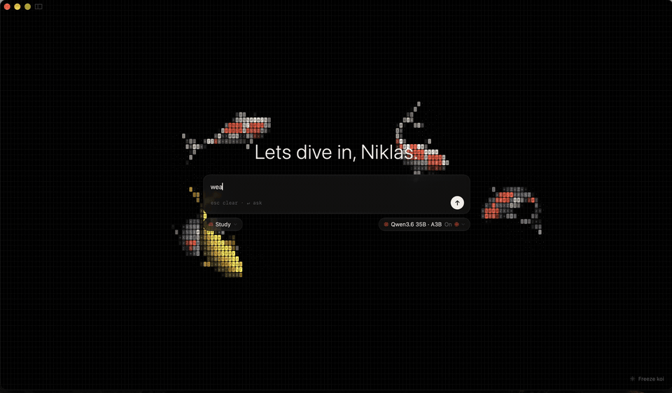
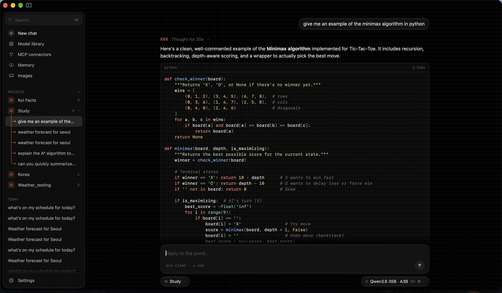
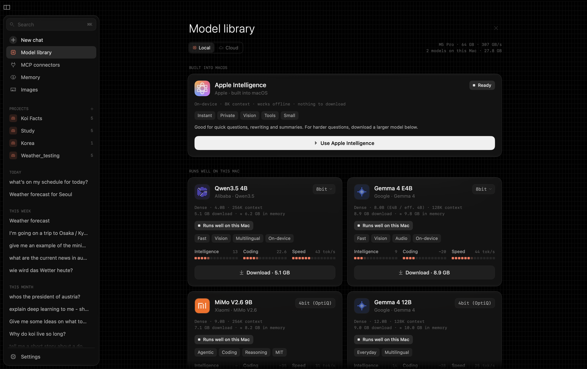
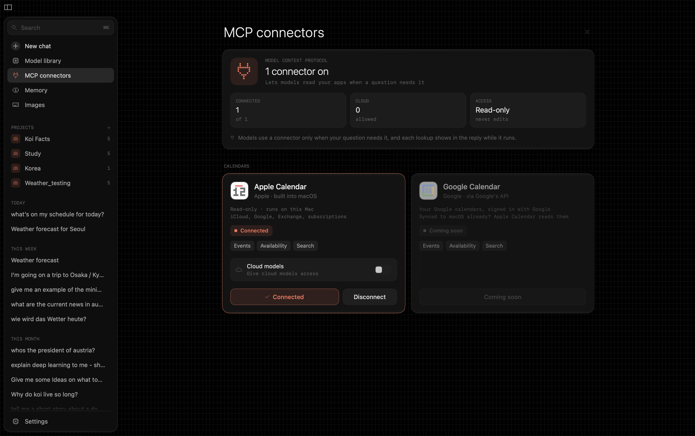

  

<h1 align="center">Koi</h1>

  <b>A native macOS assistant that runs large language models entirely on your Mac.</b> 
  Private by default, works offline, and built to feel at home on macOS.

  
  
  
  

---

Koi brings open-weight LLMs to Apple silicon with [MLX](https://github.com/ml-explore/mlx-swift),
next to Apple's own on-device Foundation Models, so you can chat before downloading anything.
Your conversations, memories and projects stay on your Mac. Tools like web search or the
calendar connector only run when a model needs them, and cloud models are strictly opt-in.

And while you think, five pixel koi swim under the glass.

## Highlights

- **Local first.** Download open-weight models (Qwen, Gemma, Mistral, Liquid AI, Xiaomi MiMo and more)
  from Hugging Face and run them with MLX. Apple's on-device model works out of the box.
- **Tools and connectors.** Web search, reading web pages, live weather and long-term memory,
  plus an Apple Calendar connector built on the **Model Context Protocol (MCP)**.
- **Memory.** Koi remembers short facts about you across chats. You can see, edit and undo
  every note, and time-bound notes ("exam next week") stop being used once they're over.
- **Projects.** Group chats into projects, and each chat can draw on what was discussed in the others.
- **Attachments.** Images go to vision models; PDFs, Word, RTF, OpenDocument, Markdown, CSV, JSON,
  HTML and source code are turned into text the model can read.
- **Thinking control.** Turn reasoning on or off, or pick an effort level, wherever the model's
  chat template supports it.
- **Bring your own key (optional).** Connect OpenRouter, NVIDIA or Mistral with your own API key.
- **Designed for the Mac.** A Liquid Glass composer, a Metal-rendered koi pond, light and dark
  themes, a peeking sidebar, and markdown with syntax highlighting and readable math.

## Demo

https://github.com/user-attachments/assets/f6d6132c-0656-461f-b16d-7bce965596c5

A 2½-minute walkthrough: asking about the weather, the model library, MCP connectors and the
calendar, settings, and writing code with a local model.

## Screenshots

| Chat | Model library | MCP connectors |
|:---:|:---:|:---:|
|  |  |  |

## How it works

### Local inference

- **One resident model.** Loading another model first releases the old weights and clears
  MLX's buffer cache, so two models never compete for memory.
- **A KV cache per chat.** Follow-up messages only prefill the new turn instead of the whole
  conversation; switching chats rebuilds the session from that chat's history.
- **Wired memory and warm-up.** While generating, the weights stay resident so macOS doesn't page
  them out mid-reply, and a one-token warm-up compiles the GPU kernels before the first real answer.
- **Context budgeting.** The system prompt, memory, project context, attachments and history are
  fitted into the model's context window, with room left for the answer.
- **Model defaults.** Sampling settings come from each model's own `generation_config.json`.
- **Loop protection.** A repetition detector (dominant lines, n-gram diversity, periodic suffixes)
  stops replies that have collapsed into an endless loop.
- **Fits your Mac.** The model library reads the chip, unified memory and memory bandwidth and
  groups models by how well they will run.

### Tools and MCP

- A small **MCP implementation**: JSON-RPC 2.0 messages, a client that performs the `initialize`
  handshake and calls `tools/list` / `tools/call`, and a host that serves connectors.
  Koi's own connectors run in-process, as the App Sandbox doesn't allow launching servers.
- The **Apple Calendar connector** reads every account synced into macOS Calendar through
  EventKit. It is read-only: models can list and search events, never change them.
- **Gemma 4 tool calls** use their own wire format, so Koi parses them out of the token stream itself.
- Models **without tool calling** still get web results and weather: Koi spots those questions and
  looks things up before the model answers.
- **Saving memories** runs as a short, separate check after each reply, which small models handle
  far more reliably than calling a tool mid-answer.

### Privacy and security

- Chats, memory and projects are stored as local files in `Application Support/Koi`.
- Koi runs in the **App Sandbox** with the hardened runtime.
- The `read_url` tool only reaches the **public web**: a guard blocks localhost, private and
  link-local ranges in every spelling (`127.1`, `0x7f.0.0.1`, …), checks where a name resolves to,
  and discards responses that came from a private address.
- Links in replies only open as web pages or mail, never as `file://`, `smb://` or app schemes.
- **API keys** live in memory only and are zeroed when you disconnect or quit. They are written to
  the Keychain only if you turn on "Remember on this Mac".

## Architecture

| Module | What's inside |
|---|---|
| `Koi/Engine` | MLX model engine, Apple Foundation Models, thinking control, tool-call parsing, markdown and math rendering |
| `Koi/Models` | Model catalog, Hugging Face downloads, model library |
| `Koi/Chat` | Conversation UI, composer, attachments, chat and project storage |
| `Koi/Memory` | Memory notes, the memory check and the Memory page |
| `Koi/Connectors` | MCP client and host, Apple Calendar connector |
| `Koi/Web` | Web search, page reader, host guard, link policy, weather |
| `Koi/Cloud` | Optional bring-your-own-key cloud providers and key storage |
| `Koi/Pond` | Koi simulation and Metal shaders |
| `Koi/Sidebar`, `Koi/Settings` | Navigation and preferences |

## Platform

Koi runs on Macs with Apple silicon and macOS 27 or later. Apple's on-device model needs
Apple Intelligence turned on; more unified memory lets you run larger local models, and the
model library shows what fits on your Mac.

## Source code

Koi is in active development and its source code is private for now. If you'd like to see the
code, for example as part of an application review, I'm happy to give you access. Just reach
out on [LinkedIn](https://www.linkedin.com/in/niklas-etzlinger-0ba9a92b1/).

## Roadmap

<!-- Adjust to your own plans. -->
- stdio and HTTP transports for third-party MCP servers
- More connectors
- More search providers (for example SearXNG)

## Built with

[MLX Swift](https://github.com/ml-explore/mlx-swift) ·
[mlx-swift-lm](https://github.com/ml-explore/mlx-swift-lm) ·
[swift-transformers](https://github.com/huggingface/swift-transformers) ·
[swift-huggingface](https://github.com/huggingface/swift-huggingface) ·
[SwiftSoup](https://github.com/scinfu/SwiftSoup) ·
weather by [Open-Meteo](https://open-meteo.com) · web search via DuckDuckGo

## License

© 2026 Niklas Etzlinger. All rights reserved.
